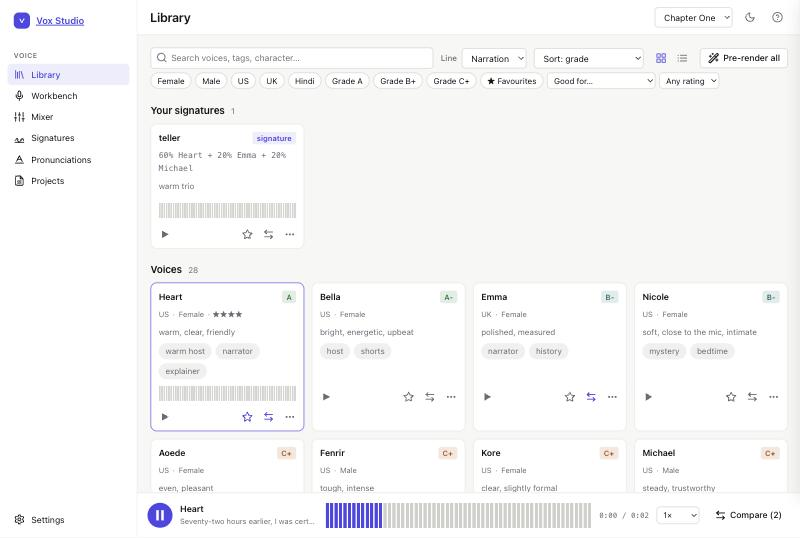
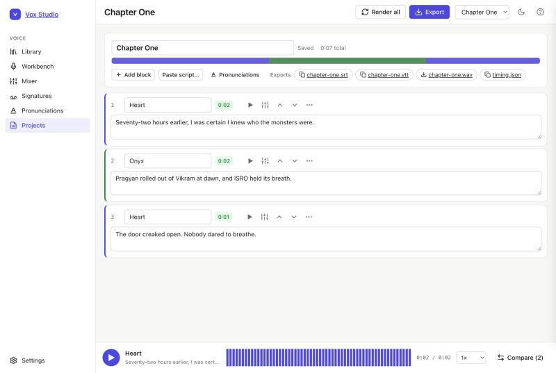

# Vox Studio

**A local, free voice studio.** Audition 30+ AI voices on your own line, blend them into new ones, tune pitch and
room sound, fix how names are said, then narrate a whole script and export audio with captions. Everything runs
on your machine. Nothing you type or render leaves it.

Think of it as the narration half of ElevenLabs Studio, running offline on a laptop, with plain YAML files
instead of an account.

<p align="center">
  
</p>

## Install

```bash
uvx voxstudio
```

or, if you prefer pipx:

```bash
pipx install voxstudio && voxstudio
```

That starts the server on `http://127.0.0.1:7860` and loads the Kokoro voice model in the background (first run
downloads about 330 MB). Python 3.10 or newer is required. `ffmpeg` is needed for pitch, effects, spaces and MP3
export (`brew install ffmpeg` or `apt install ffmpeg`); `espeak-ng` is optional and gives phoneme suggestions.

Want to see the app without downloading a model? `voxstudio --engine fake` uses tones instead of speech.

## What you can do

| Page | What it does |
|---|---|
| **Library** | Hear every voice on the same line. Filter by gender, accent and grade, search tags, favourite, rate 1–5, add tags, compare up to four voices back to back with `Space`. |
| **Workbench** | One line, any voice: speed, pitch in semitones, a character effect (robot, deep, ghost, radio…) and a space (room, hall, cave, phone…). Heard in about a second. Save presets. Download the WAV. |
| **Mixer** | Blend two to four voices with linked sliders and hear each change. Save the result as a signature voice and use it anywhere as `@name`. |
| **Signatures** | Your saved mixes: where they are used, rename (projects follow), duplicate, delete safely. |
| **Pronunciations** | Respellings (`Chun-druh-yaan`) or exact phonemes (`/pɹˈʌɡjɑn/`), shared or per project, with before/after playback and a scanner that finds names in your script. |
| **Projects** | A script in blocks, each with its own voice and settings. Render all (only changed blocks re-render), export WAV or MP3 plus SRT and WebVTT captions timed from the engine's word timestamps. |

Keyboard: `Space` play/pause, `J`/`K` move through voices, `F` favourite, `C` compare, `1`–`5` rate, `/` search,
`?` for the full list. Light and dark themes, works at phone width.

<p align="center">
  
</p>

Hear an export made with it: [docs/demo/chapter-one.mp3](docs/demo/chapter-one.mp3) with
[its captions](docs/demo/chapter-one.srt).

## How it compares

| | Vox Studio | ElevenLabs Studio |
|---|---|---|
| Runs | on your machine, offline | in the cloud |
| Price | free, MIT | subscription, per-character credits |
| Voices | Kokoro's 30+ voices and any blend of them | thousands, plus cloning |
| Quality | good for narration; not studio-grade acting | state of the art |
| Voice cloning | no | yes |
| Captions | SRT and WebVTT from word timings | yes |
| Your data | plain YAML files in a folder | their servers |
| API | local HTTP with OpenAPI docs | yes |

If you need cloning or the very best expressiveness, use a cloud service. If you want a narration tool you own,
that works on a plane and never sends your script anywhere, this is it.

## The API

Everything the app does is an HTTP call on localhost, documented at `/api/docs`.

```bash
curl -s localhost:7860/api/speak -H 'content-type: application/json' \
  -d '{"text": "Hello from the command line.", "voice": "af_heart:0.6,bf_emma:0.4", "pitch": -1, "space": "room"}'
# {"key": "…", "url": "/audio/….wav", "duration": 2.1, "cached": false, "words": [["Hello", 0.1, 0.4], …]}
```

```python
import requests
r = requests.post("http://127.0.0.1:7860/api/speak", json={"text": "Rendered from Python.", "voice": "@narrator"}).json()
open("line.wav", "wb").write(requests.get("http://127.0.0.1:7860" + r["url"]).content)
```

Projects, signatures, presets and pronunciations have CRUD routes too (`/api/projects`, `/api/signatures`, …).
Writes carry an `etag`; if the file changed on disk, the server answers 409 instead of overwriting.
A [SKILL.md](SKILL.md) in this repository teaches coding agents to use it.

There is also a small CLI for scripts:

```bash
voxstudio speak "One line to a file." --voice bm_george --pitch -2 --space hall --out line.wav
voxstudio voices
```

## The workspace

Everything lives in one folder (default `~/VoxStudio`, or `voxstudio --workspace DIR`):

```
library.yaml          favourites, ratings, tags, display names per voice
signatures.yaml       narrator: {mix: "af_heart:0.6,bf_emma:0.4", speed: 1.0, pitch: 0, note: "warm"}
pronunciations.yaml   Chandrayaan: "Chun-druh-yaan"      Pragyan: "/pɹˈʌɡjɑn/"
presets.yaml          villain: {voice: am_onyx, speed: 0.9, pitch: -2, effect: deep, space: cave}
projects/<slug>/project.yaml
cache/                rendered audio by content hash; safe to delete
exports/<slug>/       chapter-one.mp3, .srt, .vtt, timing.json
```

Plain YAML, so you can edit it by hand or keep it in git. The app never overwrites a file that changed under it.

## Engines

Kokoro-82M (Apache-2.0) is the first engine: 82 million parameters, runs on a CPU, English (US and UK), Hindi,
and several other languages. An engine is a small class with `voices()`, `speak()` and `speak_timed()`; see
[`src/voxstudio/engines/base.py`](src/voxstudio/engines/base.py). Pull requests for other engines are welcome.

## Security

The server binds `127.0.0.1` only, refuses requests whose `Host` or `Origin` is not localhost (so a web page
cannot talk to it), keeps every file path inside the workspace, and never builds shell commands from your text.

## Development

```bash
git clone https://github.com/cloudhobbit/voxstudio && cd voxstudio
uv venv && uv pip install -e ".[dev,kokoro]"
.venv/bin/pytest             # fast: a fake engine stands in for the model
.venv/bin/pytest --slow      # also one real Kokoro test
.venv/bin/voxstudio serve --engine fake --workspace /tmp/vox
```

The front end is plain ES modules and CSS under `src/voxstudio/app`: no build step, no dependencies.

## Roadmap

- More engines (Piper, Chatterbox) behind the same interface
- Per-block emphasis and pauses inside a block
- A render queue for long scripts, and chapter markers in exports
- Audiobook packaging (M4B with chapters)

## Licence

MIT. Voices by [Kokoro](https://github.com/hexgrad/kokoro) (Apache-2.0).
