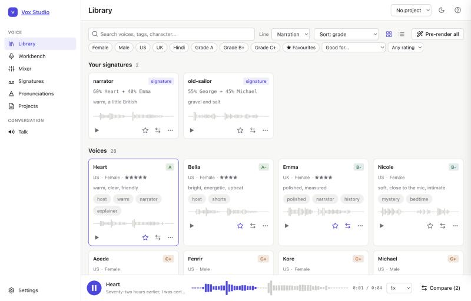
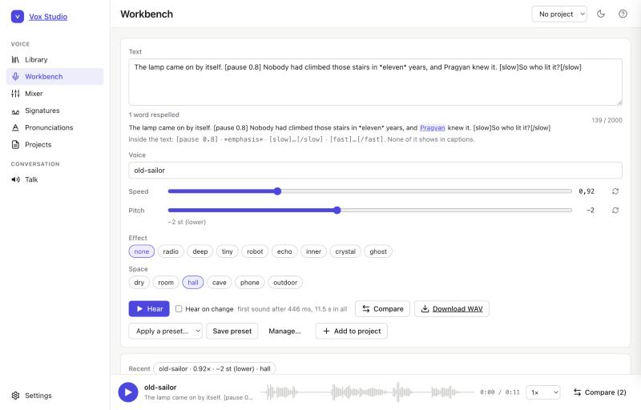
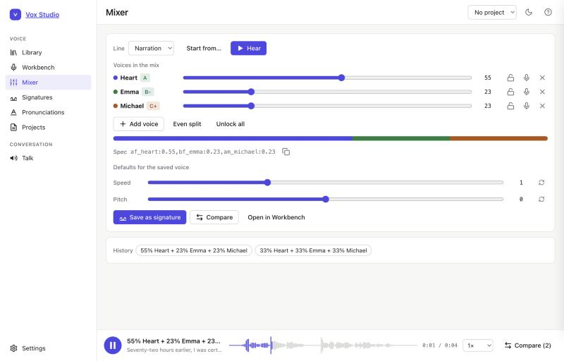
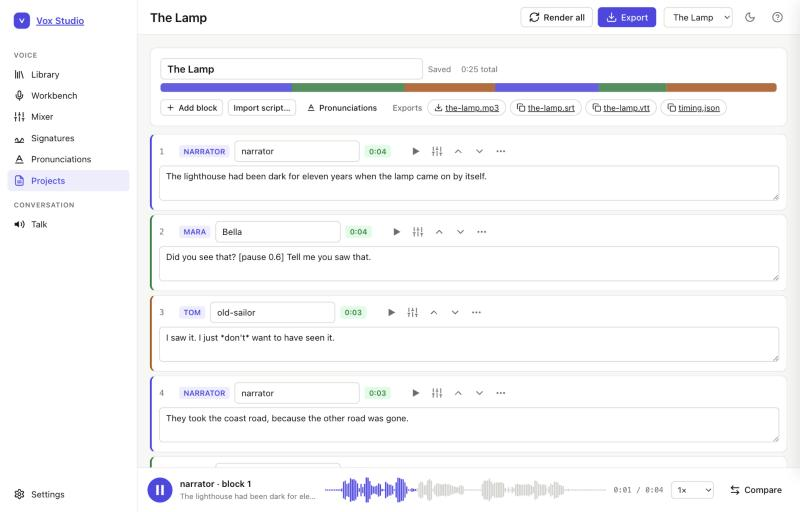
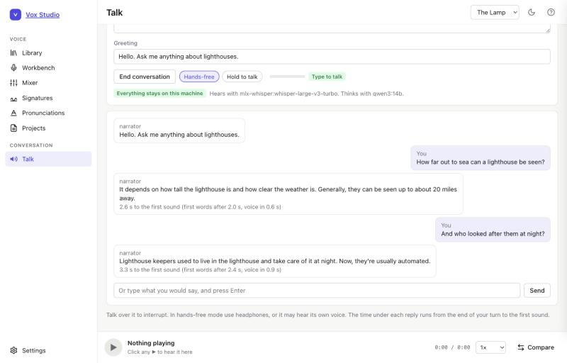
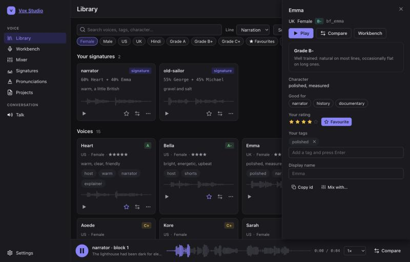

# Vox Studio

**A voice studio you start with one command.** Audition 30+ AI voices on your own line, blend them into new ones,
tune pitch and room sound, fix how names are said, narrate a whole script and export MP3 with captions. Then talk
to any of those voices. MIT, offline, no Electron, runs on a laptop CPU. Every button is also an HTTP call, so
your coding agent can use it.

[](https://github.com/cloudhobbit/voxstudio/actions/workflows/ci.yml)
[](LICENSE)


```bash
uvx --from git+https://github.com/cloudhobbit/voxstudio voxstudio
```

That is the whole install. It opens `http://127.0.0.1:7860` and loads the Kokoro voice model in the background
(the first run downloads about 330 MB). `uv` fetches Python 3.12 if yours is newer, because Kokoro has no 3.13
build yet. Once the package is on PyPI this shortens to `uvx voxstudio`.
No model yet? Add `--engine fake` to see the app with tones instead of speech.

<p align="center">
  
</p>

## What it looks like

<table>
  <tr>
    <td width="50%"><br><b>Workbench.</b> One line, any voice. Pauses, emphasis and pace are written in the text. Sound starts after the first sentence.</td>
    <td width="50%"><br><b>Mixer.</b> Blend two to four voices with linked sliders, hear each change, save the blend as <code>@narrator</code>.</td>
  </tr>
  <tr>
    <td><br><b>Projects.</b> Paste a script with <code>NAME: line</code> dialogue and each speaker gets a voice. Render, then export audio and captions.</td>
    <td><br><b>Talk.</b> A conversation with any of your voices. Each reply shows how long you waited and where the time went.</td>
  </tr>
</table>

<p align="center">
  
</p>

**Hear it.** Both files were exported by the app, captions included:

- [the-lamp.mp3](docs/demo/the-lamp.mp3): a 25-second scene with three voices, an inline pause, emphasis and a slow line, levelled to one loudness ([captions](docs/demo/the-lamp.srt)). It is the project in the screenshot above.
- [chapter-one.mp3](docs/demo/chapter-one.mp3): narration with a blended voice and fixed pronunciations ([captions](docs/demo/chapter-one.srt)).

## In numbers

Measured on an Apple M5 laptop (24 GB) on 5 November 2026, with Kokoro on the CPU. Your machine will differ. How
each was measured is in [the decision records](docs/decisions/README.md).

| What | Result |
|---|---|
| Time to first sound on a 14-second paragraph | **0.35–0.5 s**, effects included (1.4 s before streaming) |
| Speed of speech synthesis | 14 s of audio in 1.4 s: about **10× real time** |
| A line you have rendered before | served from the cache, no synthesis |
| Loudness across voices in one export | each block levelled to **−16 LUFS**; two blocks 14 dB apart come out within 1 LU |
| Talk: end of your turn to the first sound | median **2.1 s** with a 14B local model writing 13 tokens a second; the model is 1.5 s of that |
| Talk: hearing you (Whisper) | 0.4 s for a 3–8 s utterance |
| The package | a **132 KB** wheel; the front end is 22 files of plain JavaScript and CSS, 167 KB, **no dependencies and no build step** |
| The voice model | Kokoro-82M: 82 million parameters, 330 MB; 28 English voices and 4 Hindi ones here, and any blend of them |
| Tests | 122 in Python and 6 in JavaScript, in seconds, without a model; CI on macOS and Ubuntu, Python 3.10 and 3.12 |

## 20-second tour

1. **Library**: every voice says your line. Filter by gender, accent and grade, favourite, rate, tag, compare four back to back.
2. **Workbench**: pick a voice, set speed, pitch, a character effect (robot, ghost, radio…) and a space (room, hall, phone…). Write `[pause 0.8]`, `*emphasis*` or `[slow]…[/slow]` inside the text. Save it as a preset.
3. **Mixer**: blend two to four voices with linked sliders; save the blend as a signature voice, `@narrator`.
4. **Pronunciations**: `Chandrayaan: Chun-druh-yaan`, or exact phonemes. A scanner finds the names in your script.
5. **Projects**: paste or upload a script (plain text, Markdown, SRT, or `NAME: line` dialogue with a voice per speaker), render (only changed blocks re-render), export WAV or MP3 with loudness levelled across voices, plus SRT and WebVTT captions timed from the engine's word timestamps.
6. **Talk** (experimental): speak or type, and a voice answers. Talk over it and it stops.

Keyboard everywhere (`Space` play, `J`/`K` next voice, `F` favourite, `C` compare, `1`–`5` rate, `?` for the list).
Light and dark themes. Works at phone width.

## For coding agents

Everything the app does is a localhost HTTP call, documented at `/api/docs`. [SKILL.md](SKILL.md) teaches Claude
Code, Codex and friends to narrate for you: start the server, speak a line, build a project, export with captions,
fix a pronunciation. Drop it in your skills folder or point the agent at this repo.

```bash
curl -s localhost:7860/api/speak -H 'content-type: application/json' \
  -d '{"text": "Hello from the command line.", "voice": "af_heart:0.6,bf_emma:0.4", "pitch": -1, "space": "room"}'
# {"key": "…", "url": "/audio/….wav", "duration": 2.1, "cached": false, "words": [["Hello", 0.1, 0.4], …]}
```

```python
import requests
r = requests.post("http://127.0.0.1:7860/api/speak", json={"text": "Rendered from Python.", "voice": "@narrator"}).json()
open("line.wav", "wb").write(requests.get("http://127.0.0.1:7860" + r["url"]).content)
```

Projects, signatures, presets and pronunciations have CRUD routes (`/api/projects`, `/api/signatures`, …).
Writes carry an `etag`; if the file changed on disk the server answers 409 instead of overwriting.
`POST /api/speak/stream` returns raw audio while the line is still being made.

### Drop-in for the OpenAI speech API

Anything that can call `/v1/audio/speech` with a custom base URL works unchanged. The key is ignored.

```python
from openai import OpenAI
client = OpenAI(base_url="http://127.0.0.1:7860/v1", api_key="local")
client.audio.speech.create(model="tts-1", voice="alloy", input="Spoken on this machine.").write_to_file("line.mp3")
```

`voice` takes the OpenAI names (mapped to the nearest local voice), any voice id, a blend
(`af_heart:0.6,bf_emma:0.4`) or a saved `@signature`. Formats: `mp3`, `wav`, `flac`, `pcm`, `opus`, `aac`.
Extra fields `pitch`, `effect` and `space` work too. `pcm` is streamed: bytes leave after the first sentence.

### MCP server

```json
{"command": "uvx", "args": ["--from", "git+https://github.com/cloudhobbit/voxstudio", "voxstudio", "mcp"]}
```

Seven tools: `speak`, `list_voices`, `create_project`, `export_project`, `list_projects`, `set_pronunciation`,
`save_signature`. It uses the Vox Studio already running on port 7860 (so the agent and the app share voices and
projects), or starts a private one. Files are written on your machine and their paths returned. It is written
without an SDK, so it adds no dependency.

A small CLI covers scripts and cron jobs:

```bash
voxstudio speak "One line to a file." --voice bm_george --pitch -2 --space hall --out line.wav
voxstudio voices
```

## Talk to a voice (experimental)

```bash
uvx --from "voxstudio[talk] @ git+https://github.com/cloudhobbit/voxstudio" voxstudio
```

The Talk page holds a spoken conversation with any voice, blend or `@signature`: it listens, a language model
answers, and the voice speaks the answer clause by clause. Talk over it and it stops. Hands-free, hold-to-talk,
or typed.

It hears with Whisper on your machine and thinks with any server that speaks the OpenAI chat API. By default that
is an [Ollama](https://ollama.com) on this machine, using the smallest model you have; set `VOXSTUDIO_LLM_URL`,
`VOXSTUDIO_LLM_MODEL` and `VOXSTUDIO_LLM_KEY` to use another. The page tells you whether your words stay on this
machine.

Where a turn's time goes, measured through the whole loop with five spoken questions:

| Stage | Median |
|---|---|
| Waiting for the transcript after your turn ends (transcription starts during the closing pause) | 0.22 s |
| The language model's first clause (qwen3:14b, 13 tokens a second) | 1.5 s |
| The voice's first audio | 0.5 s |
| **End of your turn to the first sound** | **2.1 s** |

The target is 1.5 s and this misses it. The language model is the reason, and a faster one is the lever.
[Decision record 0007](docs/decisions/0007-talk-latency-and-the-loop.md) has the spike, the design and what is
still rough. The protocol is one WebSocket, described in [`talk/ws.py`](src/voxstudio/talk/ws.py). Use headphones
in hands-free mode, or it may hear its own voice.

## Which voice tool do you want?

| | **Vox Studio** | [VoiceStudio](https://github.com/debpalash/VoiceStudio) | ElevenLabs Studio |
|---|---|---|---|
| Install | one `uvx` line | `curl \| sh`, Electron app | web account |
| Licence | MIT | AGPL-3.0 + commercial | proprietary |
| Runs | offline, laptop CPU | offline, GPU helps a lot | cloud |
| Voices | Kokoro's 30+ and any blend | dozens of engines, 646 languages | thousands |
| Cloning, dubbing | no | yes | yes |
| Pronunciation fixes with before/after | yes | partial | yes |
| Captions from word timings | SRT, WebVTT | yes | yes |
| Per-block voice and settings in a script | yes | yes | yes |
| OpenAI-compatible endpoint, MCP server, agent skill | yes | API | API |
| Your data | one folder of YAML | app data | their servers |

Pick VoiceStudio if you need cloning, dubbing or many languages and do not mind a desktop app. Pick ElevenLabs if
you need the best acting money can buy. Pick Vox Studio when you want a narration tool you install in one line,
keep in git, and drive from scripts and agents.

## Honest limits

- Kokoro is good for narration and characters, not studio-grade acting. English (US and UK) is best.
- No cloning. That is a feature for some users and a deal-breaker for others.
- Emphasis uses the engine's stress marks and is subtle.
- Talk is experimental: about two seconds to the first sound with a mid-sized local model, a simple loudness-based
  end-of-turn detector, and one conversation at a time.
- `ffmpeg` is needed for pitch, effects, spaces, loudness levelling and MP3 (`brew install ffmpeg` or
  `apt install ffmpeg`). Without it you still get plain speech and WAV. `espeak-ng` is optional and adds phoneme
  suggestions.

## The workspace

Everything lives in one folder (default `~/VoxStudio`, or `voxstudio --workspace DIR`):

```
library.yaml          favourites, ratings, tags, display names per voice
signatures.yaml       narrator: {mix: "af_heart:0.6,bf_emma:0.4", speed: 1.0, pitch: 0, note: "warm"}
pronunciations.yaml   Chandrayaan: "Chun-druh-yaan"      Pragyan: "/pɹˈʌɡjɑn/"
presets.yaml          villain: {voice: am_onyx, speed: 0.9, pitch: -2, effect: deep, space: cave}
projects/<slug>/project.yaml
cache/                rendered audio by content hash; safe to delete
exports/<slug>/       the-lamp.mp3, .srt, .vtt, timing.json
```

Plain YAML, so you can edit it by hand or keep it in git. The app never overwrites a file that changed under it.

## Engines

Kokoro-82M (Apache-2.0) is the first engine: it runs on a CPU and gives word timestamps for captions.
An engine is a small class with `voices()`, `speak_stream()` and `speak_timed()`; see
[`src/voxstudio/engines/base.py`](src/voxstudio/engines/base.py). Pull requests for other engines are welcome.

## Docker

A CPU `Dockerfile` is included. No image is published yet, so build it yourself:

```bash
docker build -t voxstudio . && docker run --rm -p 127.0.0.1:7860:7860 -v voxstudio:/data voxstudio
```

The model and your workspace live in the `/data` volume. Publishing the port on `127.0.0.1` keeps it off your
network; there is no login.

## Security

The server binds `127.0.0.1` unless you pass `--host`, refuses requests and WebSockets whose `Host` or `Origin`
is not localhost (so a web page cannot talk to it), keeps every file path inside the workspace, and never builds
shell commands from your text.

## Development

```bash
git clone https://github.com/cloudhobbit/voxstudio && cd voxstudio
uv venv && uv pip install -e ".[dev]"
.venv/bin/pytest                     # seconds: fakes stand in for every model
.venv/bin/pytest --slow              # also one real Kokoro test
node --test tests/js/*.test.mjs      # front-end logic
.venv/bin/voxstudio serve --engine fake --workspace /tmp/vox
```

The front end is plain ES modules and CSS under `src/voxstudio/app`: no build step, no dependencies.
See [CONTRIBUTING.md](CONTRIBUTING.md).

## Roadmap and decisions

Next: Talk under 1.5 seconds with a small local model, saved personas, and exported conversations.
[ROADMAP.md](ROADMAP.md) lists every item with a success measure and says plainly which were met.
[docs/decisions](docs/decisions/README.md) holds seven short records of the choices behind the design, including
the measurements that changed it.

## Licence

MIT. Voices by [Kokoro](https://github.com/hexgrad/kokoro) (Apache-2.0).
